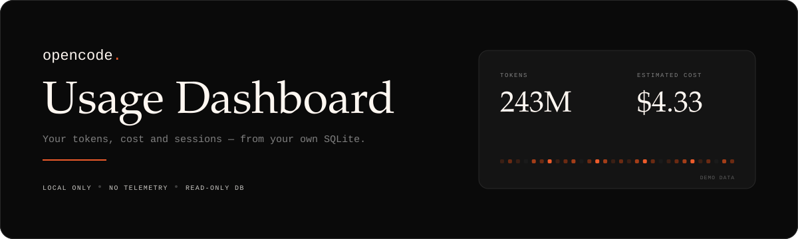
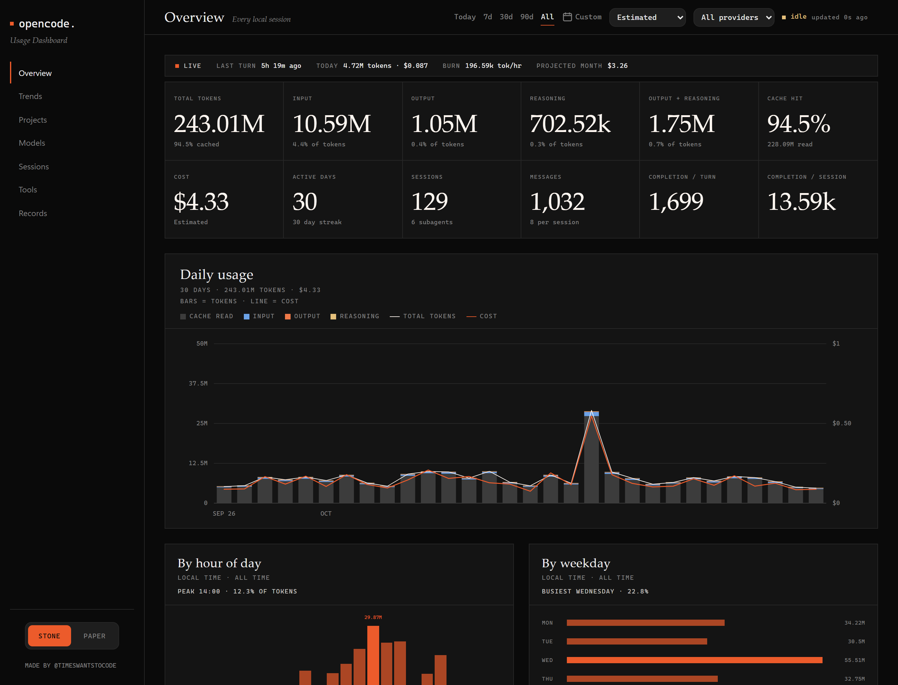
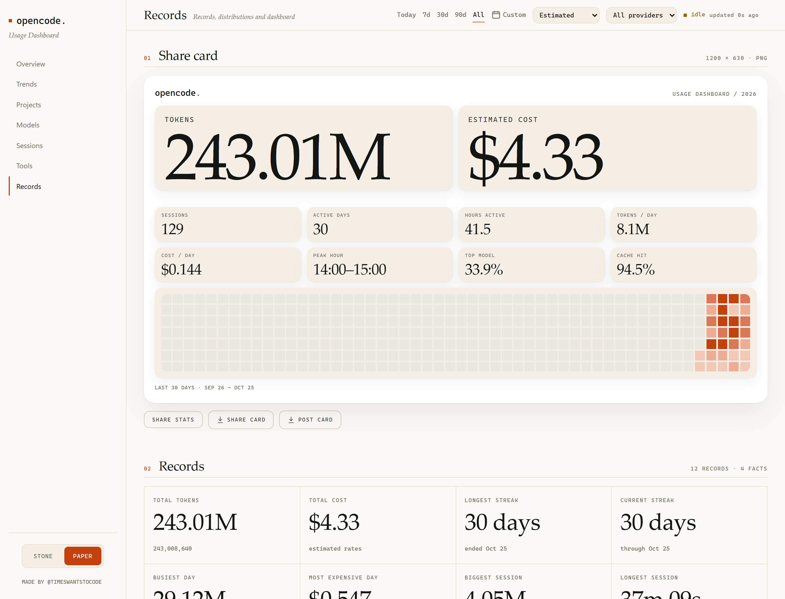
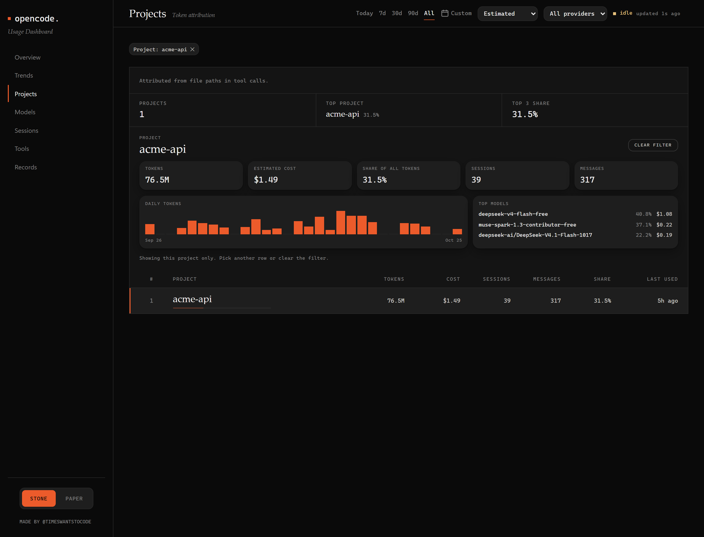

<div align="center">

<h1>opencode-usage-dashboard</h1>

*Your OpenCode usage, tokens and cost — on your machine, from your own SQLite.*




[Quick start](#quick-start) · [Screenshots](#screenshots) · [Agent setup](#agent-setup) · [Features](#features) · [Design](#design) · [How it works](#how-it-works) · [Privacy](#privacy)

</div>

OpenCode Usage Dashboard is a local, read-only dashboard for [OpenCode](https://opencode.ai). It reads the SQLite database OpenCode already keeps on your machine and turns assistant-message token counts into seven pages of live usage and estimated cost: Overview, Trends, Projects, Models, Sessions, Tools, and Records.

Everything runs on localhost. Nothing is uploaded, there is no account and no telemetry, and the source database is never written to. A small sidecar cache keeps the pages fast without touching the original file on every request.

<a name="agent-setup"></a>
## 🤖 Set it up with your agent

<details>
<summary><strong>Copy this prompt into OpenCode — it sets the whole thing up for you</strong></summary>

Paste the block below into OpenCode. The agent finds your database, sets your timezone, installs and builds, researches the prices of the models you actually used, asks you to confirm them, writes `pricing.local.json`, and asks you to verify both totals.

```text
You are setting up the OpenCode Usage Dashboard in this repository. Work on
this machine only and follow the steps in order. Ask a question and wait
whenever a step says to ask. Never guess a value.

0. Get the project. If the current directory is not already the dashboard,
   clone it and enter it:
     git clone https://github.com/Timeswantstocode/opencode-usage-dashboard.git
     cd opencode-usage-dashboard
   If you are already inside a checkout, stay there. Confirm `package.json`
   has `"name": "opencode-usage-dashboard"` before continuing.

1. Check the toolchain. Confirm `node -v` is 24 or newer (`node:sqlite` is
   required), then confirm `pnpm -v`. Install dependencies with `pnpm install`;
   if pnpm is unavailable, use `npm install` and `npm run` for every script
   below. Stop and explain if either check fails.

2. Find the OpenCode SQLite database.
   - macOS/Linux: `~/.local/share/opencode/opencode.db`
   - Windows: `%USERPROFILE%\.local\share\opencode\opencode.db`, or
     `%LOCALAPPDATA%\opencode\opencode.db` when the first path does not exist.
   If neither file exists, stop and ask the user where OpenCode stores its
   database. Do not create, migrate, or repair a database.

3. Detect this machine's UTC offset in whole minutes (for example,
   `node -e "console.log(-new Date().getTimezoneOffset())"`) and a short zone
   label (for example `EST` or `CET`). Create `.env.local` with
   `TZ_OFFSET_MINUTES=<minutes>` and `TZ_LABEL=<label>`. Add
   `OPENCODE_DB=<absolute path>` only when the database is not in a location
   the app resolves by itself. If `.env.local` already exists, show the exact
   diff first and wait for approval before overwriting it.

4. Verify the app. Run `pnpm typecheck`, then `pnpm build`, then `pnpm dev`.
   Open <http://localhost:4321> and load
   <http://localhost:4321/api/stats?range=all>. Confirm `totals.tokens.total`
   and `totals.messages` are greater than zero. If either is zero, stop and ask
   before continuing. Fix nothing else.

5. List the real usage. From the same `/api/stats?range=all` response, read
   `models` (provider, model, variant, tokens, messages) and `providers`.
   Build a table of every model with its input, output, cache-read, and total
   token counts. Do not skip a model you do not recognise.

6. Research prices for exactly those models from public sources: models.dev
   first, then the provider's own pricing page. For each model record the
   input, output, and cached-read price per 1M tokens in USD, the source URL,
   and the date checked. Note the currency and unit on the page before
   converting anything. If no public price exists, mark the model unpriced.

7. Ask the user, then wait for answers:
   a. Do you pay for any of these providers, or are they free or part of a
      subscription?
   b. For each `*-free` model, which paid model should it be priced as in
      Estimated mode?
   c. Is your provider's pricing peak/off-peak or tiered by volume?

8. Write `pricing.local.json` in the repository root, using only rates the
   user confirmed. Follow the shape in `pricing.local.example.json`: a
   `fallback` object plus a `models` map keyed by provider/model, each entry
   with `input`, `output`, and `cacheRead`. Never invent a number. Leave
   unconfirmed models out and list them as unpriced, then ask.

9. Stop and restart the dev server so every request reads the current
   `.env.local` and price file. Open the Records tab, then Pricing. Report the
   Estimated total, the Metered total, and every unpriced model. Ask the user
   to compare both totals with their provider dashboard.

10. Report a short summary: the database path, the timezone, models priced,
    models still unpriced, both totals, and what the user should check next.

Hard rules:
- The OpenCode database is read-only. Never run INSERT, UPDATE, DELETE, or a
  schema change against it.
- Never upload, paste, or print transcript text, prompts, or tool output.
  Model ids, token counts, and totals are enough.
- Do not commit `.env*`, `pricing.local.json`, `.data/`, or `.shots/`. Check
  `git status` before you finish.
- Every price you record needs a URL and a date checked. No source, no rate.
- Ask before guessing. When unsure, stop and leave the value unset.
```

</details>

Prefer to do it yourself? [Quick start](#quick-start).

## Screenshots

Captured from the dashboard running on a synthetic demo database — no real usage.



*Overview: live totals, daily tokens and cost, 365-day activity.*



*Records: share card, streaks, provider ledger.*



*Projects: per-project cost and a filtered detail view.*

## About

**opencode-usage-dashboard** — a read-only local dashboard for OpenCode usage: tokens, sessions, projects, and estimated cost from your own SQLite database.

`opencode, opencode-ai, usage, tokens, cost, dashboard, nextjs, sqlite, local-first, analytics`

**What you get**

- Lifetime and per-range totals for tokens, messages, sessions, and estimated cost, with daily trends and a 365-day activity calendar.
- Token mix across input, output, reasoning, cache read, and cache write, with cache hit rate and estimated savings.
- Breakdowns by project, provider, model, and tool — including the rate used for each model.
- Session and trend views: the heaviest sessions, hour-of-week heatmap, period comparisons, rollups, streaks, records, and anomaly flags.
- Two pricing views (estimated list rates and metered only), local rate overrides, and a share card built from lifetime totals.
- A Claude-style editorial interface in two themes (Stone and Paper), with keyboard navigation and hover detail on every chart.

## Quick start

Requires **Node.js 24+** (the dashboard uses the built-in `node:sqlite`) and pnpm; npm works as a fallback.

```bash
pnpm install
pnpm dev
```

Open <http://localhost:4321>. The first request backfills the sidecar cache — about 4 seconds on a typical history — and later requests read only new rows.

On Windows, run `start.cmd`. On macOS or Linux, run `./start.sh`. Both check Node, install dependencies when `node_modules` is missing, print the URL, and start the dev server.

Using npm instead: `npm install` and `npm run dev`.

<a name="features"></a>
## Features

| Page | What it shows | Why it matters |
| --- | --- | --- |
| **Overview** | Live totals, daily charts, a 365-day calendar, and an hour-of-week heatmap. | See where you stand right now without opening a spreadsheet. |
| **Trends** | Period comparisons, weekly and monthly rollups, anomalies, session-duration distribution, cumulative curves, and generated insights. | Spot a change in pace before it becomes a surprise on the invoice. |
| **Projects** | Tokens, cost, share, sessions, messages, and last use per project; selecting one filters every page. | Find which repository is responsible for the bill. |
| **Models** | Provider, model, and variant breakdown with token mix, messages, rate used, and cost. | Compare models on real usage, not list prices. |
| **Sessions** | The 300 heaviest sessions in the range, with span, messages, cost, project, agent, and a subagent marker. Open one for its own token and tool detail. | Audit the most expensive conversations without reading their transcripts. |
| **Tools** | Tool-call counts by tool, error rate, and the token volume of the messages that issued them; code output stats for the selected range. | See which tools are noisy, failing, or producing the most code. |
| **Records** | High-water marks, streaks, peak hours, distributions, the full metric ledger, and the share card. | Find your best days and export a summary worth posting. |

Charts and figures carry hover tooltips with the exact numbers. The Records page downloads a **1200×630 PNG share card** and a **1080×1350 (4:5) Instagram card**.

## Design

The interface follows a **Claude-style editorial layout**: warm parchment and near-black stone surfaces, a single clay accent, serif display type, monospaced tabular figures, generous margins, rounded elevated cards with soft shadows, and no chart junk.

Two themes ship: **Stone** (dark) and **Paper** (warm light), switchable in the sidebar and remembered across pages. The screenshots above show both.

## How it works

```text
OpenCode SQLite (read-only)        sidecar cache              dashboard
~/.local/share/opencode/opencode.db ──> .data/usage.db ──> localhost:4321
                                   incremental rowid cursor
```

- **No network.** The app makes no outbound request — no telemetry, analytics, fonts, or CDN.
- **2-second live polling.** The browser refreshes `/api/stats` while the tab is visible.
- **4-second first backfill.** The initial scan of a typical history takes about 4 seconds; after that, an incremental rowid cursor reads only new rows.

## Pricing

Rates are USD per 1M tokens, and reasoning tokens are billed at the output rate. Two cards show the same usage two ways:

| Mode | Behavior |
| --- | --- |
| **Estimated** | The default. Built-in rates price known models; unmatched models use the configurable fallback rate. |
| **Metered** | Prices only models a provider actually bills; everything else is `$0`. Useful for checking free-tier usage against an invoice. |

Built-in rates cover the models the dashboard knows about. To correct or add a rate, copy `pricing.local.example.json` to `pricing.local.json` (git-ignored):

```json
{
  "fallback": { "label": "My provider", "input": 0.5, "output": 1.5, "cacheRead": 0.05 },
  "models": {
    "provider/model-id": { "input": 1, "output": 2, "cacheRead": 0.1 }
  }
}
```

`models` entries win over built-in rules and match model ids case-insensitively; `fallback` replaces the Estimated card's unmatched-model rate and label. The file is re-read when it changes, so no restart is needed.

**Every figure is an estimate, not an invoice.** OpenCode persists only completed assistant messages, so retries, title generation, compaction, and aborted streams never reach the dashboard. Provider invoices, plan terms, and taxes are authoritative.

<a name="privacy"></a>
## Privacy

Everything stays on your machine. The source database is opened read-only (`pragma query_only = 1`), and the cache stores token counts and session metadata — never prompts, message text, code, or tool output. There is no telemetry and no outbound request. Read the full note in [docs/PRIVACY.md](docs/PRIVACY.md).

Local and git-ignored:

- `.data/` — the sidecar usage cache.
- `pricing.local.json` — your own rates.
- `.env*` (except `.env.example`), `.shots/`, logs, and `*.tsbuildinfo`.

## Configuration

The database is auto-detected at `~/.local/share/opencode/opencode.db`, or `%LOCALAPPDATA%\opencode\opencode.db` on Windows when that path is missing. Copy `.env.example` to `.env.local` to override anything; Next.js loads that file automatically.

| Variable | Default | Purpose |
| --- | --- | --- |
| `OPENCODE_DB` | Auto-detected | Absolute path to OpenCode's SQLite database. |
| `TZ_OFFSET_MINUTES` | Machine offset | Minutes east of UTC used to bucket days and hours. |
| `TZ_LABEL` | `LOCAL` | Short label displayed beside the clock. |
| `NEXT_DEV_INDICATORS` | off | Set to 1 to show the Next.js dev-tools bubble. |
| Port | `4321` | `pnpm dev -- -p 4322` to use another port. |

## Troubleshooting

| Symptom | Fix |
| --- | --- |
| Database not found | Confirm OpenCode has created `opencode.db`, or set `OPENCODE_DB` to its absolute path. The dashboard never creates, migrates, or repairs it. |
| Port 4321 is busy | `start.cmd` and `./start.sh` detect this and offer to start on 4322 — answer `Y` and open <http://localhost:4322>. For a manual run, use `pnpm dev -- -p 4322`. |
| Data looks stale or the cache is corrupt | Stop the server, delete `.data/usage.db` and its `-wal`/`-shm` siblings, then start again or run `pnpm backfill`. |
| `node:sqlite` is unavailable | Node is older than 24 or built without SQLite. Install Node 24+, then check with `node -e "require('node:sqlite')"`. |
| Unknown models show `$0` | In Metered mode that is expected. Add a `models` entry in `pricing.local.json`, or switch to Estimated so unmatched models use the fallback rate. |
| First load is slow or totals are zero | The first request is backfilling; wait a few seconds and reload. If totals stay zero, check the database path and that the file holds completed assistant messages. |

## Contributing

See [CONTRIBUTING.md](CONTRIBUTING.md). Bug reports and pull requests are welcome — run `pnpm typecheck` and `pnpm build` before opening a PR. Please do not include personal data, prompts, session titles, or real spend figures in issues, screenshots, or commits.

## License

[MIT](LICENSE) © 2026 OpenCode Usage Dashboard contributors.
